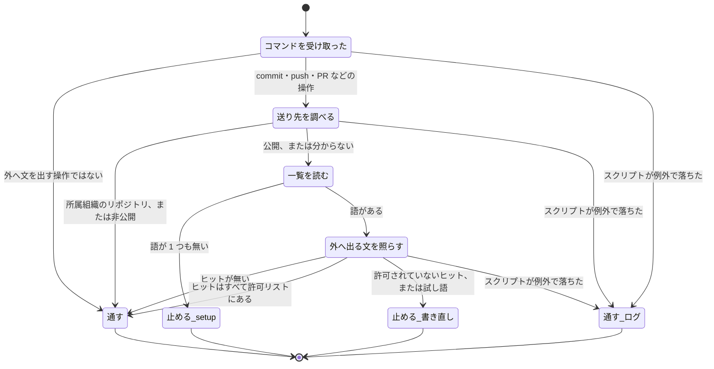

# public-guard: 公開リポジトリに外に出さない語を出さないプラグイン

2026-11-20 に合意 (design-flow の grilling、Q1〜Q9)。手元で使っていた同じ名前のフック (2026-11-18 合意) を、誰でも入れられるプラグインに作り直したもの。

## Problem Statement

仕事や別の契約先で見た事例を手がかりに、自分の公開リポジトリを直すことがある。そのとき Agent が、所属組織のリポジトリ名・顧客名・社内の名前を、公開リポジトリのコミットメッセージや PR 本文にそのまま書いてしまう。履歴を書き換えて force-push しても、PR 本文の編集履歴と force-push 前のコミットは GitHub に残る。一度出たものは完全には消せないので、出る前に止めたい。

手で書いたフックを PC ごとに登録する形では、PC を増やすたびに配る手間がかかり、登録を忘れた PC では何も言わずに素通りする。

## Solution

プラグインが、検証済みのガードのスクリプトと `hooks/hooks.json` を同梱する。`/plugin install` した時点で、Claude Code の PreToolUse (`Bash|PowerShell`) にフックが入る。フックは、Agent が公開リポジトリへ文を出す操作 (commit・push・PR や issue の作成と編集など) の直前に、外へ出る文を手元だけに置いた「外に出さない語の一覧」で照らし、ヒットしたら止めて、一般化して書き直すよう Agent に返す。

スキル `public-guard` は、引数で 4 つの仕事を受け持つ。一覧を作る (`setup`)、公開リポジトリに残った語を報告する (`audit`)、ガードが本当に効いているかを確かめる (`doctor`)、出てしまったときの後始末を案内する (`cleanup`)。Codex にはプラグインが無いので、`setup` でスクリプトを決まった場所に写して Codex のフックに登録する。

## 用語

- **公開リポジトリ**: GitHub で visibility が PUBLIC のリポジトリ。持ち主は問わない。所属組織が持つものは除く。
- **外に出さない語**: 公開リポジトリに書いてはいけない語。所属組織の名前とリポジトリ名 (自動の一覧)、顧客名・社内の名前・案件の番号の形など (手書きの一覧)。
- **外へ出る文**: 操作によって GitHub に書かれる文。差分・コミットメッセージ・PR や issue のタイトルと本文・コメント・リリースノート・公開 gist・`gh api` で送る値。
- **一覧の置き場所**: `~/.config/public-guard/` (環境変数 `PUBLIC_GUARD_HOME` で変えられるのはテストのため)。どのリポジトリにも入れない。
- **許可リスト**: リポジトリごとに、持ち主が「この語はここでは出してよい」と決めた語。`allow/<owner>__<repo>.txt`。
- **試し語 (canary)**: どの一覧にも書かずに、いつも止める決まった語。`doctor` が、本物のフックの経路で止まるかを確かめるのに使う。スクリプトが組み立てて渡し、文書やソースにはそのまま書かない。

## User Stories

1. 利用者として、Agent が公開リポジトリに外に出さない語を含むコミットをしようとしたら止まってほしい。履歴に入る前に気づけるから。
2. 利用者として、`gh pr create`・`gh pr edit`・`gh issue`・`gh release`・公開 gist・`gh api` の書き込みも、文とファイル (`--body-file` など) を照らしてほしい。PR 本文は編集履歴に残り、消しにくいから。
3. 利用者として、`git push` では push 先にまだ無いコミットの差分とメッセージを照らしてほしい。ガードの外で作ったコミットもあるから。
4. 利用者として、`git add -A && git commit` のように 1 つのコマンドでまとめたときも、作業ツリーの差分を照らしてほしい。フックの時点ではまだ stage されていないから。
5. 利用者として、他人の公開 OSS への PR も照らしてほしい。漏れる先は自分のリポジトリだけではないから。
6. 利用者として、所属組織のリポジトリと非公開のリポジトリでは照らさないでほしい。そこでは組織の語を書くのが正しいから。
7. 利用者として、非公開を公開に変える操作の前には全履歴を照らしてほしい。非公開の間に入った語が一度に出るから。
8. 利用者として、公開かどうか分からないときは公開とみなしてほしい。照らすのは手元で済み、ヒットが無ければ通るから。
9. 利用者として、止まったときは、どの語がどこでヒットしたかと、一般化して書き直すことを Agent に返してほしい。
10. 利用者として、Agent がフラグや環境変数で検査を飛ばせないようにしてほしい。
11. 利用者として、誤検知は許可リストでそのリポジトリだけ通したい。許可リストは自分が「入れて」と言ったときだけ書かれてほしい。
12. 利用者として、一覧はどのリポジトリにも入れたくない。一覧のファイルを誤って公開リポジトリに入れようとしても、ガード自身が止めてほしい。
13. 利用者として、所属組織の名前とリポジトリ名は自動で一覧にしてほしい。古くなったら作り直してほしい。短い名前は初めから除外したい。
14. 利用者として、組織に入っていなくても、顧客名や個人の情報を手で書いて使いたい。
15. 利用者として、手書きの一覧の初版は Agent に候補を集めてもらい、公開リポジトリでの誤検知を測ってから、自分で確かめて決めたい。
16. 利用者として、プラグインを入れたのに一覧がまだ無いときは、公開リポジトリへの操作を止め、`setup` を案内してほしい。素通りを防ぎたいから。
17. 利用者として、スクリプト自体が例外で落ちたときは操作を通し、ログに残してほしい。ガードの不具合で作業全体が止まるのは困るから。
18. 利用者として、ガードが本当に効いているかを、本物の外に出さない語を使わずに確かめたい (`doctor` の試し語)。node が無いとフックは何も言わずに通るから。
19. 利用者として、Codex でも同じスクリプトで守りたい。プラグインを更新したら、Codex 側の写しが古いことを `doctor` で知りたい。
20. 利用者として、自分の公開リポジトリに語が残っていないかを報告してほしい (直すかは自分が決める)。
21. 利用者として、出てしまったときの後始末 (編集履歴の版を消す、履歴を書き換える、GitHub Support に頼む) の手順を読みたい。
22. 利用者として、プラグインを更新しても一覧と許可リストはそのまま残ってほしい。

## Implementation Decisions

- **形**: プラグイン `public-guard` (`plugins/public-guard/`)。中身は次のとおり。
  - `hooks/hooks.json`: PreToolUse、matcher `Bash|PowerShell`、`node "${CLAUDE_PLUGIN_ROOT}/scripts/public-guard.mjs"`、timeout 60 秒。
  - `scripts/public-guard.mjs`: Node 20 以上で動く 1 本。入口は、引数なし (フック)・`init`・`refresh`・`audit`・`doctor`・`selftest`・`codex-install`。
  - `skills/public-guard/SKILL.md`: 引数 `setup`・`audit`・`doctor`・`cleanup` で分ける。後始末の手順は付録に置く。
  - `tests/public-guard.test.mjs`: `node --test`。架空の語だけを使う。リポジトリの CI には足さない。
- **操作の見分け・外へ出る文の集め方・公開の判定・照らし方**: 手元版と同じ。commit (メッセージ・`-F` のファイル・stage 済みの差分、`git add` か `-a` があれば作業ツリーと未追跡も)、push (push 先に無いコミット)、gh (コマンドの文と渡したファイル)、公開への切り替え (全履歴)。追加された行だけを見る。所属組織 (`orgs.txt`) と PRIVATE・INTERNAL は対象外、分からなければ公開。公開判定は 1 時間キャッシュ。英数字の語は語の区切りで、日本語は部分一致で、大文字・小文字を区別せずに照らす。正規表現は `re:` を前に付ける。
- **一覧**: `deny.txt` (手書き)・`auto.txt` (`refresh` が `gh` で作る)・`exclude.txt` (自動の分から外す。6 文字以下の名前は初めから入る)・`orgs.txt`・`allow/`。自動の分が 7 日より古ければ、フックの裏で作り直す。
- **一覧が無いとき**: `deny.txt` にも `auto.txt` にも語が無ければ、公開リポジトリへの操作を止め、`/public-guard:public-guard setup` を案内する。
- **試し語**: スクリプトの中で組み立てる決まった語。どの公開リポジトリでも、許可リストに関わらず止める。`selftest` が一時のリポジトリ (公開かどうか分からない架空のリモート) と、試し語を書いたメッセージのファイルを作り、Agent が流すための `git commit -F` のコマンドを出す。Agent がそれを Bash で流して止まれば、フックは本物の経路で効いている。止まらなければ、一時のリポジトリの中にコミットができるだけで、外には出ない。
- **Codex**: `codex-install` が、スクリプトを `~/.config/public-guard/bin/public-guard.mjs` に写し、`~/.codex/hooks.json` の PreToolUse (matcher `Bash`) に登録する。何度流しても同じ結果になる。プラグインの置き場所は版ごとに変わるので、直接は指さない。`doctor` は写しと同梱の版の違いを知らせる。
- **doctor**: node の版、一覧の語の数と自動の分の日付、`gh` の認証、Codex の登録と写しの版、Claude Code の設定に手で登録した同じガードが残っていないか (二重になる) を報告する。最後に `selftest` で本物の経路を確かめる。
- **抜け道を作らない**: 検査を飛ばすフラグや環境変数は無い。`PUBLIC_GUARD_HOME`・`PUBLIC_GUARD_GH` はフックのプロセスの環境変数で、コマンドの文からは変えられない。
- **書くもの**: SKILL.md・README・止めたときの文は日本語。`plugin.json` の description は英語。中身に、特定の組織・顧客・語を書かない。
- **対象外**: API キーなどの秘密情報 (gitleaks・GitHub の secret scanning を README で案内する)。

### 判定の流れ (状態の図)

`止める_setup` は「`setup` を案内して止める」、`止める_書き直し` は「ヒットした語と場所を返して、一般化して書き直させる」。`通す_ログ` は、ガードの不具合で作業全体を止めないための逃げ道で、ログに残す。

## Testing Decisions

- **よいテスト**: 外から見た振る舞いだけを確かめる。PreToolUse の JSON と、そのときのリポジトリ・一覧に対して、止めたか通したか、理由に何が書かれたかを見る。
- **seam**:
  1. フックの入口 (主): 標準入力に JSON を渡し、標準出力の JSON を見る。テストごとに一時の git リポジトリと一時の設定フォルダを作る。公開かどうかはキャッシュを先に置いて決め、ネットワークに出ない。
  2. `audit --repo-dir`: 一時のリポジトリでヒットが報告に出る。
  3. `codex-install`: 一時のホームに 2 回流し、2 回目は何も変わらず、登録が 1 つだけある。
  4. `selftest`: 出したコマンドをフックに渡すと止まる。`doctor`: 一覧が無ければそう報告する。
- **確かめるもの**: 手元版の 37 件 (commit・push・gh の各操作、組織と非公開、分からない送り先、消した行、許可リスト、一覧が無い、壊れた JSON、一覧のファイルそのもの、環境変数での抜け道、公開への切り替え、gist、PowerShell) に、試し語・`init`・`codex-install`・`doctor` を足す。
- **実際に止まることの確認**: テストとは別に、本物の Claude Code のセッションで、プラグインのフックが試し語のコミットを止めることを確かめる。本物の公開リポジトリには何も出さない。

## Out of Scope

- 人が手で打つ git や gh の操作 (全体の `core.hooksPath` は、各リポジトリの `.git/hooks` を効かなくするので使わない)
- スクリプトのファイルの中で git を呼ぶ形 (`bash x.sh`)
- 語では照らせない「業務の内容」。Agent への決まり (CLAUDE.md・AGENTS.md) で一般化させる。README で書き方の例を示す。
- LLM に意味を読ませる検査
- 秘密情報の検出
- Write・Edit の時点での検査 (外へ出るのは commit・push の時点)
